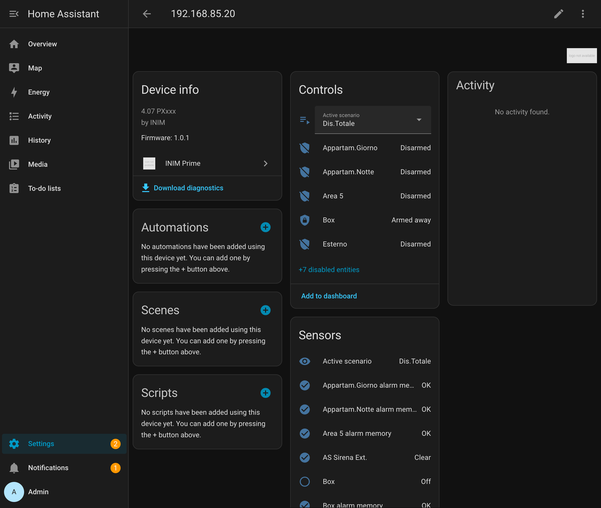
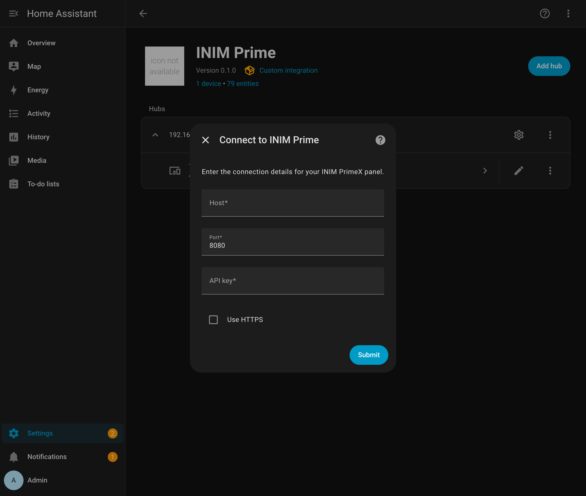

<p align="center">
  
</p>

<h1 align="center">INIM Prime — local Home Assistant integration</h1>

<p align="center">
  <a href="LICENSE"></a>
  <a href="https://github.com/thekoma/inim-prime-local/actions/workflows/validate.yml"></a>
  <a href="https://github.com/hacs/integration"></a>
  
</p>

A **local, offline-first** Home Assistant integration for **INIM Prime / PrimeX** alarm panels. It talks **only** to the panel on your LAN, over the panel's native TCP 6004 protocol (the channel Prime/STUDIO itself uses) — **no cloud account, no INIM cloud, no rate limits, no HTTP API key.** The only credential is the panel's LAN password.

<p align="center">
  
</p>

## Features

| Area of the panel | Home Assistant entity | What you get |
|---|---|---|
| 🛡️ **Areas / partitions** | `alarm_control_panel` (one per area) | Arm **away / home / night**, disarm; live armed/disarmed/triggered state |
| 🎬 **Scenarios** | `button` (one per scenario) + per-scenario `binary_sensor` *(disabled by default)* | Apply any arming scenario. A scenario reads *active* while every area it sets is in the mode it sets, so several can be active at once |
| 🚪 **Zones** | `binary_sensor` (one per zone) | Open / closed in realtime; device class (and so the icon) from the panel programming where it is explicit (fire, shock, roller shutter — *moving*, since the detector senses the shutter moving, not its position, with shutter icons), otherwise guessed from the zone name in **12 languages** — window, door, garage, motion, smoke, gas, CO, water, vibration, tamper ([details](docs/known-limitations.md)) |
| 🚫 **Zone bypass** | `switch` (one per zone) | Include / exclude a zone from arming |
| ⚡ **Outputs** | `switch` (one per panel output) | Toggle panel outputs, named as programmed on the panel *(hidden by default)* |
| 🔋 **Power & faults** | `sensor` + `binary_sensor` | Supply and battery voltage, battery temperature and internal resistance, open-zone count, system fault + a per-fault breakdown (mains, battery, tamper — with which device reports it —, GSM, …) |
| 📶 **GSM / LTE** | `sensor` | Signal level, with networks, operator code, VoLTE and the communicator's faults as attributes (only on panels with the module) |
| 🧹 **Alarm memory** | `button` (one per area) | Clear alarm memory; per-area alarm-memory sensors |
| 🩺 **Diagnostics** | `binary_sensor` + device page | Service mode (SERV jumper) and programming mode; panel model and firmware; downloadable diagnostics (LAN password redacted) |

Only the areas you choose get entities (**Options → Areas to show**, by area number; until you save a choice, every area with a real name is shown and unused factory-default ones like `AREA 006` are skipped). The **output switches** and the **per-scenario "active" sensors** are hidden by default so your entity list stays clean — re-enable any you actually use.

**Which** areas, zones, scenarios and outputs exist, their names and how each zone is programmed are read once at setup; their live state is then read every 2 seconds. Reload the integration after changing the panel programming.

## Why local?

This integration never touches the INIM cloud. The mobile app and most other integrations rely on `inimcloud.com`, which is subject to INIM's tightening rate limits and means your alarm depends on an external service. Here, Home Assistant and your panel talk directly over your LAN. See [Alternatives](#alternatives-and-prior-art) for cloud-based options if you prefer broader panel coverage.

## Installation

### HACS (recommended)
1. HACS → ⋮ → **Custom repositories** → add `https://github.com/thekoma/inim-prime-local` as an **Integration**.
2. Install **INIM Prime**, then restart Home Assistant.

### Manual
Copy `custom_components/inim_prime/` into your Home Assistant `config/custom_components/` directory and restart.

## Configuration

Nothing needs enabling on the panel: the native protocol (TCP port 6004) is always on. You need the panel's IP address and its **LAN password**, the one Prime/STUDIO uses to connect over the network (factory default `pass`). Then in Home Assistant: **Settings → Devices & Services → Add Integration → INIM Prime**.

<p align="center"></p>

| Field | Notes |
|---|---|
| **Name** | Friendly name for the panel (e.g. `Allarme`). Used for the device and entity names — so entities read `Allarme Finestra Camera`, **not** the panel IP. |
| **Host** | Panel IP, e.g. `192.168.1.50` |
| **Panel LAN password** | The panel's LAN/programming password (default `pass`) |

### Rooms & areas

By default the integration **groups each zone (and its bypass switch) under a per-room device** — *Camera*, *Taverna*, *Bagno*, *Garage*… — inferred from the zone name in your language. In the post-setup "assign areas" dialog (and later in **Settings → Areas**) you then drop each room device into the matching Home Assistant **area**, in one step per room. Zones whose name has no recognisable room stay on the main panel device. Turn this off with **Group zones by room** in *Configure* if you'd rather keep everything on one device.

**Changed the LAN password or the panel address?** Use **⋮ → Reconfigure** on the integration to update them without removing anything.

**Upgrading from a version that used the panel's HTTP API (before 2026.10.7):** the entry is migrated on the first start. The API key, port, HTTPS and polling settings are dropped, every entity keeps its id and history, and the three API diagnostic sensors (*API version*, *API connections*, *Last API client*) are removed. Nothing else is needed: those versions already required the LAN password. If nothing else uses the panel's HTTP API, you can turn it off in Prime/STUDIO.

## Settings

Open **Configure** on the integration.

| Option | Default | Meaning |
|---|---|---|
| **Areas to show** | every area with a real name | The panel areas that get entities, kept by area number ([details](docs/configuration.md)) |
| **Enable realtime push** | off | Register a local webhook for instant updates (see below) |
| **Zone label language** | Auto | Language used to guess each zone's icon (and room) from its name (window/door/garage/motion/smoke/…). *Auto* follows Home Assistant's language; 12 languages are supported. |
| **Group zones by room** | on | Place each zone under a per-room device (Camera, Bagno, Garage…) guessed from its name, so you can assign whole rooms to HA areas. |

### How it reads the panel

Every **2 seconds** the integration sends four read-only status commands over one persistent TCP connection: the areas, the zones, the outputs and the panel status (faults, tampers, voltages). Each answers in about 10 ms on a PrimeX 4.07, so a change shows up within ~2 s without any push setup, and the panel is not loaded. The battery temperature and internal resistance are read once a minute, and the GSM status every 5 minutes. The integration has no polling options: there is nothing to tune.

**Built-in protection so HA never suffers:** each read has a 5 s ceiling and the whole cycle 20 s; a failed cycle keeps the last good state, and entities go *unavailable* only after 3 failed cycles in a row; after 3 failures the integration reads every 30 s until the panel answers again; and at most one cycle is ever in flight. See [polling & tuning](docs/polling-and-tuning.md).

## Realtime (optional, fully local)

Polling is already snappy, but you can get **instant** updates with zero cloud:

- **Panel HTTP event-push → HA webhook** (this integration). Enable *realtime push* in the options; HA shows you a local webhook URL. In PrimeStudio's *event-action ("Invio pagine web")* table, point the events you care about at that URL (each entry encodes its zone/area/event in the URL). The panel then pushes events to HA and entities update optimistically and instantly; the 2 s poll stays on and reconciles. See [docs/realtime.md](docs/realtime.md) for the exact setup and the per-event URL scheme.
- **SIA-IP** (alternative). The panel can also report events to Home Assistant's built-in [`sia`](https://www.home-assistant.io/integrations/sia/) integration over the standard SIA-DC09 protocol — another fully-local realtime path. Documented in [docs/realtime.md](docs/realtime.md) as an alternative.

> The INIM **cloud** websocket is intentionally **not** used — depending on the cloud for a security alarm's realtime path defeats the purpose of a local integration.

## Arm-mode mapping

Home Assistant's three arm modes map to the panel like this:

| Home Assistant | Panel arming |
|---|---|
| Arm **away** | Total |
| Arm **home** | Partial |
| Arm **night** | Instant / snapshot |
| **Disarm** | Disarm |

## Forced arming (arm with open zones)

Before arming, the integration reads the zones that matter live and refuses to arm while one of them is open ("not ready"), with a clear *zones not ready* error. The zones that matter are those of the areas being armed, less the ones the panel leaves out of that arming: zones programmed *Autoescludibile* (the panel bypasses them itself) and, for home or night arming, *Interna* zones. To arm **anyway**, bypassing the open zones first (the same thing the official app's *"Forzatura inserimento"* does), use the action **`inim_prime.arm_forced`**:

```yaml
- action: inim_prime.arm_forced
  data:
    entity_id: alarm_control_panel.inim_prime_home   # any INIM Prime entity; identifies the panel
    scenario: "Ins.Notte"        # apply a scenario by name…
    # or, targeting an area instead (entity_id must then be that area's alarm panel):
    #   mode: night              # away | home | night
    allow_partial: false         # default: refuse if a zone can't be bypassed
  response_variable: forced
# forced.bypassed_zones / forced.unbypassable_zones list what happened
```

- **Fail-closed by default**: if an open zone *cannot* be bypassed (programmed *Non escludibile*, or the panel does not apply the bypass), nothing is armed and the action raises, naming the zones. Set `allow_partial: true` to bypass what it can and arm anyway (it still reports what stayed open).
- **Verified**: every bypass is read back from the panel before arming.
- **Rollback**: if the arm itself certainly did not reach the panel, any zone the action bypassed is re-included — the panel is never left *bypassed but disarmed*.
- **Never silent**: every forced arm fires an `inim_prime_forced_arm` event (handy for logbook/automations).
- The bypassed zones stay bypassed until you un-bypass them (per-zone bypass switches) — automatic restore on disarm is planned.

> Forced arming **reduces protection** on the bypassed zones. It is an explicit action, never automatic.

## Security notes

The native protocol is AES-encrypted with the panel's LAN password as the key and a fixed IV: it keeps casual eavesdroppers out, but anyone who knows the password can read and command the panel. Treat it accordingly:

- **Keep it on the LAN.** Never port-forward TCP 6004 (or the panel's web server) to the internet. For remote access use a VPN.
- **Change the LAN password** from the factory default `pass` in Prime/STUDIO, then update it here with *Reconfigure*.
- **Commands carry no user code**, and the alarm panels in Home Assistant do not ask for one: whoever controls Home Assistant controls the alarm, so protect access to it.

## Supported panels

| Panel | Status |
|---|---|
| INIM **PrimeX** (firmware 4.07) | ✅ Primary development hardware |
| INIM **PrimeX / Prime** (firmware 5.00) | ✅ Everything except the **event log**: its location in the 5.00 memory map is not known yet |
| Other firmware families | ❌ Setup stops with *firmware not supported*: the native memory map is specific to each firmware family (4.x, 5.x) |

SmartLiving / Nexus panels use a different protocol and are **not** covered here (see Alternatives).

## Documentation

- [Configuration](docs/configuration.md) — add, reconfigure and migrate the integration, choose the areas
- [Polling & tuning](docs/polling-and-tuning.md) — how the panel is read, what is read at setup, safety guards
- [Realtime](docs/realtime.md) — local webhook event-push and the SIA-IP alternative
- [Native commands](docs/native-commands.md) — how commands are sent, their safety rules and frames
- [Examples & use cases](docs/examples.md) — automations and dashboards
- [Known limitations](docs/known-limitations.md)
- [Reporting issues](docs/reporting-issues.md)

## Quality

Engineered to the Home Assistant **Platinum** quality-scale rules: fully type-annotated (`mypy --strict`, no ignores), **100% test coverage**, config + reauth + reconfigure flows, entity/exception/icon translations, diagnostics, dynamic entity lifecycle, and zero external runtime dependencies (the native client is vendored). Per-rule status is tracked in [`custom_components/inim_prime/quality_scale.yaml`](custom_components/inim_prime/quality_scale.yaml). *(The official Quality Scale badge applies only to core integrations; this custom integration meets the rules but is, by definition, in the "Custom" tier.)*

## Testing

This integration ships a real test suite (uncommon for this ecosystem): pure-client unit tests, Home Assistant integration tests, and a **live end-to-end** test against a real panel — all runnable via Docker:

```bash
make unit      # pure client tests
make ha-unit   # Home Assistant integration tests
make e2e       # live end-to-end (needs a reachable panel; reads .env)
```

**Pre-commit gates.** A [`.pre-commit-config.yaml`](.pre-commit-config.yaml) mirrors the CI *Validate* checks locally so a failing push is caught before it reaches CI: `ruff` on every commit, and `mypy --strict` + the full `pytest` suite (100% coverage) at push time. The pytest guardrails also replicate the common **hassfest** failures (translation placeholders/key-parity, `services.yaml`↔`strings.json` drift, manifest key order). Enable with:

```bash
pip install pre-commit
pre-commit install --install-hooks   # with the dev test env on PATH
```

## Alternatives and prior art

This project is local-first and specific to INIM **Prime / PrimeX** over the panel's native protocol. If it doesn't fit your setup, these community projects are worth a look:

- **[pla10/homeassistant_inim_alarm](https://github.com/pla10/homeassistant_inim_alarm)** — the most established INIM integration. Cloud-based (INIM Cloud) with WebSocket push and an optional local SIA-IP listener; covers SmartLiving and Prime. Choose it for broad panel coverage if a cloud dependency is acceptable.
- **[Pitscheider/ha_inim_prime](https://github.com/Pitscheider/ha_inim_prime)** — a local Prime integration over the PrimeLAN Web API with rich fault/GSM diagnostics and four arm modes.
- **[Pitscheider/inim-prime-native](https://github.com/Pitscheider/inim-prime-native)** (GPL-3.0) — a Python library for the panel's native TCP 6004 protocol. This integration's live status reads (partition and terminal status commands), its structure read (label tables, zone settings) and its commands (set arming status, zone bypass, output, partition reset) follow the layouts documented there.
- **[matteoraf/ha-inim_smartliving_alarm_panel](https://github.com/matteoraf/ha-inim_smartliving_alarm_panel)** — fully local integration for **SmartLiving** panels over the native TCP protocol.
- **[nidble/pyinim](https://github.com/nidble/pyinim)** — a reusable async Python library for the INIM cloud API.

## License

GPL-3.0 — see [LICENSE](LICENSE). Releases up to 2026.9.0 were published under the MIT license.

## Disclaimer

Community project, **not affiliated with or endorsed by INIM Electronics**. It communicates only with your own panel on your own network. Use at your own risk; an alarm system is safety-critical — verify behaviour before relying on it.
